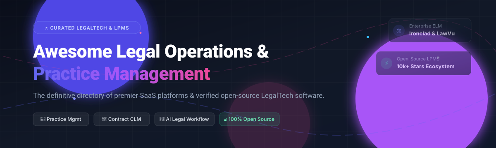

  

# ⚖️ Awesome Legal Operations & Practice Management

> 🌟 A curated index of premier **Legal Practice Management Software (LPMS)**, **Enterprise Legal Management (ELM)**, **Contract Lifecycle Management (CLM)** SaaS platforms, and top **open-source legal solutions** for law firms, legal operations teams, corporate legal departments, and solo practitioners.

---

## 📑 Table of Contents
- [📊 Sector Overview & Market Dynamics](#-sector-overview--market-dynamics)
- [🏢 SaaS & Hosted Commercial Platforms](#-saas--hosted-commercial-platforms)
- [🔓 Open-Source Software & Repositories](#-open-source-software--repositories)
- [🔍 Key Evaluation Criteria for Legal Operations](#-key-evaluation-criteria-for-legal-operations)
- [💖 Support & Sponsorship](#-support--sponsorship)
- [📈 Star History](#-star-history)
- [🤝 Contributing](#-contributing)
- [📄 License](#-license)

---

## 📊 Sector Overview & Market Dynamics

The global **Legal Practice Management Software (LPMS)** market is valued at approximately **$2.4 Billion (2024–2025)** and is projected to expand at a compound annual growth rate (**CAGR**) of **11.2%–14.6%**, with the broader LegalTech, ELM, and CLM software ecosystem exceeding **$30 Billion**. 

The sector remains **moderately fragmented**—driven by an extensive long tail of regional and niche practice management providers serving solo and small-to-midsize law firms, alongside rapid consolidation by private equity sponsors and growth-stage incumbents (e.g., Clio, CARET, Onit) acquiring point solutions to build unified, end-to-end legal operating systems.

---

## 🏢 SaaS & Hosted Commercial Platforms

Below is a comparative breakdown of the top commercial SaaS solutions for legal practice management, enterprise legal operations, and contract management, **sorted in descending order by company scale** (estimated enterprise valuation or annual revenue).

| 🏷️ Company / Product | 🏢 Company Scale (Valuation / Revenue) | 💵 Starting Tier Pricing | 🎁 Free Tier / Free Trial Limits | 🎯 Primary Category & Capabilities |
| :--- | :--- | :--- | :--- | :--- |
| **[Zoho Contracts](https://www.zoho.com/contracts/) / [Zoho Legal](https://www.zoho.com/)** | **~$15B - $20B** valuation / ~$1.4B+ ARR *(Zoho Corp)* | **$60/user/month** (Standard plan, billed annually) | **Forever Free plan**: Up to 3 users, 10 active contracts, 1 approval workflow; 15-day free trial on paid plans (no credit card required) | Enterprise Contract Lifecycle Management (CLM), governance, and custom legal workflows |
| **[Clio](https://www.clio.com/)** | **$3.0B** valuation *(Series F, 2024)* / ~$200M+ ARR | **$49/user/month** (EasyStart plan, billed annually) | **7-day free trial** (Clio Manage) / **14-day free trial** (Clio Work AI); full feature access, no credit card required | Comprehensive law practice management, time tracking, legal billing, trust accounting, and client intake |
| **[Ironclad](https://ironcladapp.com/)** | **$3.2B** valuation *(Series E)* / ~$100M+ ARR | **~$2,500 - $3,500/month** ($30,000–$40,000 base annual contract) | **14-day guided proof-of-concept / sandbox trial** available upon qualified enterprise sales consultation | AI-driven Contract Lifecycle Management (CLM), digital contracting, clickwrap, and negotiation workflows |
| **[MyCase](https://www.mycase.com/)** | **~$1.0B+** valuation *(Acquired by Apax Partners / CARET)* | **$50/user/month** (Basic plan, billed annually) | **10-day free trial**; full platform access, unlimited matters, no credit card required | All-in-one law firm practice management, legal billing, client portal, and document automation |
| **[PracticePanther](https://www.practicepanther.com/)** | **~$600M - $1.0B** valuation *(Part of CARET / Apax Partners)* | **$49/user/month** (Solo plan, billed annually) | **7-day free trial**; complete access to case tracking, automated billing, and PantherPayments demo | Legal practice management software tailored for solos, boutique, and mid-sized law firms |
| **[CARET Legal](https://caretlegal.com/)** | **~$500M+** valuation *(Formerly AbacusNext / CARET)* | **$79/user/month** (Enterprise plan, billed annually) | **10-day free trial**; full access to enterprise matter tracking, document management, and accounting tools | End-to-end legal practice and financial management built for growing law firms and legal teams |
| **[SimpleLegal](https://www.simplelegal.com/)** | **~$200M+** valuation equivalent *(Acquired by Onit)* | **~$1,000/month** ($12,000 base annual platform fee + matter volume) | **14-day enterprise trial / custom sandbox evaluation** available via guided sales onboarding | Corporate enterprise legal operations (ELM), legal spend management, e-billing, and matter intake |
| **[Brightflag](https://www.brightflag.com/)** | **~$150M - $250M** valuation / ~$20M+ ARR | **~$1,500/month** ($18,000 base annual contract, scaled by outside counsel spend) | **14-day guided evaluation sandbox** for in-house corporate legal teams upon demo qualification | AI-powered enterprise legal operations, automated invoice auditing, e-billing, and outside counsel tracking |
| **[Smokeball](https://www.smokeball.com/)** | **~$100M - $200M** valuation / ~$30M+ ARR | **$49/user/month** (Smokeball Bill tier, billed annually) | **14-day free trial** for Smokeball Bill entry tier; interactive guided demo environment with sample matter data | Automatic time and activity tracking, legal document automation, and case management software |
| **[LawVu](https://lawvu.com/)** | **~$80M - $120M** valuation *(Series B)* / ~$15M+ ARR | **$500/month** (LawVu Draft tier; enterprise workspace custom-scaled) | **14-day guided corporate workspace trial**; includes unlimited free collaborator seats for business stakeholders | Unified corporate "Legal Workspace" (LegalOS) uniting contracts, matters, e-billing, and knowledge |

---

## 🔓 Open-Source Software & Repositories

Explore vetted open-source software, legal automation libraries, smart contract engines, and AI workflow plugins, **sorted in descending order by GitHub stargazers count**.

| 📦 Repository & Project | ⭐ GitHub_Stars | 💻 Tech Stack & License | 📝 Overview & Core Features |
| :--- | :--- | :--- | :--- |
| **[anthropics/claude-for-legal](https://github.com/anthropics/claude-for-legal)** |  | Python / TypeScript • Apache-2.0 | Advanced suite of specialized AI plugins and agent workflows designed for corporate legal operations, contract auditing, compliance checking, and document diligence. |
| **[open-legal-products/mike](https://github.com/open-legal-products/mike)** |  | TypeScript / Python • AGPL-3.0 | Modern open-source legal AI platform engineered for contract drafting, case analysis, semantic clause search, and automated legal document synthesis. |
| **[General-Legal/legal-templates](https://github.com/General-Legal/legal-templates)** |  | Markdown / Text • CC0-1.0 | Extensive, battle-tested public domain collection of legal documents, counsel agreements, startup templates, NDAs, and corporate operational contracts. |
| **[zubair-trabzada/ai-legal-claude](https://github.com/zubair-trabzada/ai-legal-claude)** |  | Markdown / Prompts • MIT | Complete autonomous AI Legal Assistant skills: 14 modular skills and 5 parallel agents for contract review, risk analysis, NDA creation, and compliance auditing. |
| **[ankane/awesome-legal](https://github.com/ankane/awesome-legal)** |  | Markdown • CC0-1.0 | Curated directory of open legal documents, corporate counsel templates, privacy policies, term sheets, and operational agreements. |
| **[jhpyle/docassemble](https://github.com/jhpyle/docassemble)** |  | Python / YAML • MIT | Free, open-source expert system for guided legal interviews and automated document assembly used worldwide by legal aid and law clinics. |
| **[Automattic/legalmattic](https://github.com/Automattic/legalmattic)** |  | Markdown • CC-BY-SA-4.0 | Democratized, production-grade legal policies, Terms of Service, Privacy Policies, and DMCA frameworks open-sourced by Automattic (WordPress.com). |
| **[ncc-erp/metasign](https://github.com/ncc-erp/metasign)** |  | Java / Vue • MIT | Self-hosted e-contract and document execution solution providing end-to-end digital signing, approval chains, and operational contract management. |
| **[accordproject/template-archive](https://github.com/accordproject/template-archive)** |  | JavaScript / Cicero • Apache-2.0 | Smart legal contract repository standardizing computable legal contracts, data models, and natural language execution logic. |
| **[AnttiHero/lavern](https://github.com/AnttiHero/lavern)** |  | Python / TypeScript • Apache-2.0 | Autonomous agentic legal workspace with 67 specialist AI agents that review legal documents through evidence-backed debate and multi-pass verification. |
| **[stella/stella](https://github.com/stella/stella)** |  | Python / React • GPL-3.0 | Modular open-source legal workspace and matter intelligence tool providing case management, notes, and legal document tracking. |
| **[openlawteam/openlaw-core](https://github.com/openlawteam/openlaw-core)** |  | Scala • Apache-2.0 | Core engine enabling dynamic legal contract generation, automated clause variables, and binding digital execution. |
| **[Mahender22/legal-mcp](https://github.com/Mahender22/legal-mcp)** |  | TypeScript • MIT | Comprehensive Model Context Protocol (MCP) server connecting LLMs to case law, legal citations, court filings, and practice management APIs. |
| **[legalopsconsulting/lpm-skills](https://github.com/legalopsconsulting/lpm-skills)** |  | Markdown / JSON • MIT | Specialized AI skill framework codifying formal Legal Project Management (LPM) methodologies, matter phase tracking, and budgeting. |

---

## 🔍 Key Evaluation Criteria for Legal Operations

When selecting legal software or self-hosting open-source LPMS solutions, consider these critical pillars:

1. 🔐 **Data Security & Confidentiality**: SOC 2 Type II, ISO 27001, end-to-end encryption, and jurisdictional data residency.
2. 💰 **Trust Accounting & IOLTA Compliance**: Three-way trust bank reconciliation, ledger audit trails, and strict compliance with legal ethics regulations.
3. ⚡ **Automation & Time Capture**: Passive/active background billable hour tracking, automated LEDES 1998B invoicing, and e-billing validations.
4. 🤖 **AI Governance & Redlining**: Human-in-the-loop review, deterministic audit trails, and hallucination safeguards for contract reviews.
5. 🔗 **Extensibility & API Integrations**: Open REST/GraphQL APIs, native MCP connectors, and integrations with document storage (OneDrive, Google Drive, NetDocuments).

---

## 💖 Support & Sponsorship

Thank you so much for taking the time to explore this curated index! If you found this repository helpful, please consider supporting the project:

- ⭐ **Star this repository** to help others discover it.
- 🍴 **Fork it** and add your own customized legal operations toolchains.
- 📢 **Share it** on LinkedIn, X/Twitter, or with your legal engineering and legal ops peers.
- ☕ **Buy me a coffee / Sponsor**: If this project saved you time or aided your research, consider supporting ongoing maintenance on GitHub Sponsors:
  
  

---

## 📈 Star History

---

## 🤝 Contributing

Contributions, feature additions, and corrections are welcome!
1. 🍴 Fork the repository.
2. 🌿 Create your feature branch (`git checkout -b feature/new-legal-tool`).
3. 💾 Commit your changes (`git commit -m 'feat: add open-source case manager'`).
4. 🚀 Push to the branch (`git push origin feature/new-legal-tool`).
5. 📬 Open a Pull Request.

---

## 📄 License

This repository is distributed under the [MIT License](LICENSE).
